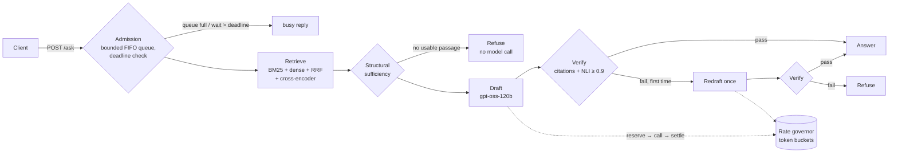

# The Relay

A question-answering service over exactly three arXiv papers that answers only with cited, verified sentences,
and is built to behave predictably under bursts, rate limits and overload.

| Paper | Version |
|---|---|
| Attention Is All You Need (`AIAYN`) | 1706.03762v7 |
| Moshi (`MOSHI`) | 2410.00037v1 |
| H-Net (`HNET`) | 2507.07955v2 |

It runs against Groq's free tier (`openai/gpt-oss-120b`) or against a Go stand-in that imitates Groq's
limits, latency and errors, so load tests never spend real quota.

## Request pipeline



Each step is a plain Python function (`relay/pipeline.py`); `relay/main.py` puts the HTTP front door, queue
and tracing around it.

1. **Admission** (`relay/main.py`). A bounded FIFO queue. A request is refused at once when the queue is full
   or its estimated wait exceeds its deadline. A request that would miss its deadline while waiting gets a
   "busy" reply.
2. **Retrieve** (`relay/retrieval/`). Hybrid search: BM25 plus BGE-small embeddings in FAISS, fused with
   reciprocal rank fusion (RRF), then optionally re-ranked by a cross-encoder. The result is packed into a
   1,600-token context. The three retrieval settings compared in the experiments live in
   `config/retrieval_settings.yaml`.
3. **Structural sufficiency** (`relay/verify/sufficiency.py`). If retrieval returned nothing usable, the
   request is refused without calling the model.
4. **Draft** (`relay/llm/`). One call to `openai/gpt-oss-120b` (`reasoning_effort: low`). The prompt asks
   for an answer where every sentence cites a retrieved passage, e.g. `[MOSHI:4.2:c017]`.
5. **Verify** (`relay/verify/`, policy `v4`, frozen). This step makes no model calls. It checks that:
   - every sentence cites a passage that was actually retrieved;
   - a local NLI model (`DeBERTa-v3-base-mnli-fever-anli`) judges that the cited passage entails the
     sentence with probability ≥ 0.9, after LaTeX is normalised (`mathnorm.py`);
   - table values belong to the row the sentence names (`tables.py`);
   - formulas appear in the cited passage, up to notation (`formulas.py`);
   - "X is not mentioned" claims are not contradicted by retrieved text (`absence.py`).
6. **Redraft** (at most once). The model gets the verifier's objections and tries again.
7. **Answer or refuse.** Nothing is sent until the whole answer verifies, so the first token arrives at the
   same moment as the full answer, and no unverified sentence ever reaches the user.

Only the draft and redraft steps call the model.

### Handling limits (`relay/governor/`, `relay/llm/hosted.py`)

- **Rate governor.** Every hosted call, retries included, reserves from token buckets that mirror Groq's
  per-minute and per-day limits (`config/limits.yaml`). After the call, the reservation is settled against
  the actual token usage.
- **When Groq returns 429 (rate limited).** The bucket freezes until the time given by `retry-after`.
- **When the daily quota runs out.** New requests get an immediate "today's model capacity is used, full
  answers resume in about N minutes" reply. The service never falls back to a cheaper model.
- **Retries.** At most 2 per call, on 5xx errors, timeouts and per-minute 429s. Each retry waits
  max(`retry-after`, jittered backoff) and is capped at 10% of first attempts per minute. A retry never
  runs past the request's deadline and never follows a per-day 429.
- **Traces.** Every request writes one trace record (`results/raw/traces/`) with the time spent queued,
  waiting on the governor, retrieving, calling the provider and retrying.

## What else is in the repo

| Part | Where | What it does |
|---|---|---|
| Ingestion | `relay/retrieval/` | Fetches the exact paper versions, parses the LaTeX source (checked against the PDF), chunks text and table rows (`{PAPER}:T{n}:r{NN}`), builds the BM25 and FAISS indexes into `data/` |
| Stand-in model service | `standin/` (Go) | OpenAI-compatible server. Replays recorded real answers by `question_id`, with Groq-style token buckets, 429 bodies, streaming, slowdowns and injected faults |
| Load generator | `loadgen/` (Go) | Open-loop Poisson load. Scenarios in `config/scenarios/`: smoke, steady, burst, overload, rpm_halved, daily_exhausted, retrieval_A/B/C |
| Evaluation | `relay/eval/`, `eval/` | Retrieval recall on the 30-question set (`eval/questions.jsonl`), plus verifier test sets and their reports (`eval/reports/`) |
| Results | `results/` | `raw/` (append-only run logs and traces), `results.csv` (one row per request), `retrieval_eval.csv`, `tables.md` |
| Report | `writeup/` | Template, generated markdown and the 2-page PDF |
| Design | `docs/DESIGN.md` | Original plan. §20.3 records what was actually built and every deviation from the plan |

## Results and honest status

- Load tests (`results/results.csv`, Tables 1–3) ran on the stand-in with verifier **v2**. The submitted
  verifier is **v4**, which was never load-tested. Every completed stand-in request was a refusal, so the
  load tests measure admission, limits, retries and latency, not answers served.
- 7 real Groq calls were made, out of 8 approved. Three questions ran end to end, and all three were refused:
  one correctly, as unanswerable, and two because the verifier wrongly rejected correct, cited claims.
  **Answer quality is not established, and the required 15-question real-model evaluation was not completed.**
- Planned in `docs/DESIGN.md` but **not built**: the LangGraph state machine, the gpt-oss-20b fallback,
  pressure levels, the response cache, single-flight, and stand-in fixtures that react to the prompt.

## Running it

```bash
uv sync                                                   # Python 3.12 env + deps
# offline ingestion
uv run python -m relay.retrieval.fetch_papers && uv run python -m relay.retrieval.latex_parse \
  && uv run python -m relay.retrieval.pdf_validate && uv run python -m relay.retrieval.chunker \
  && uv run python -m relay.retrieval.index_build
# stand-in (terminal 1)
cd standin && go run ./cmd/standin -config ../config/standin.json -port 8001 -root ..
# app against the stand-in (terminal 2)
LLM_PROVIDER=standin GROQ_API_KEY=dummy GROQ_BASE_URL=http://127.0.0.1:8001/v1 \
  uv run uvicorn relay.main:app --host 127.0.0.1 --port 8000 --workers 1
# load test
cd loadgen && go run ./cmd/loadgen -scenario ../config/scenarios/burst.json -root ..
# results, tables and report
uv run python scripts/make_results_csv.py && uv run python scripts/make_retrieval_csv.py \
  && uv run python scripts/make_tables.py
uv run python scripts/build_writeup.py && uv run python scripts/render_writeup.py
# tests
uv run pytest -q tests/unit tests/integration && (cd standin && go test ./...) && (cd loadgen && go test ./...)
```

Real Groq needs a key in `.env` (git-ignored) and `ALLOW_REAL=1`. Real calls spend shared daily quota.
